## ☕ I'm Nick

*Backend Developer · Java & Spring Boot · AWS*

Software Engineering student at Universidad de La Salle and freelance developer. I build APIs with **Java and Spring Boot**, deploy them on **AWS**, and maintain web applications for real clients.

- 🎳 I have a client in production: **[La Bolera Universo](https://bowlingdemo.nick-bern.com)**, a management and scoring system for a bowling alley.
- 🌿 I built **[Mercado Páramo](https://github.com/DevNico2905/mercado-paramo)**, a direct-sale API for rural farmers ([live Swagger](https://api.mercadoparamo.nick-bern.com/swagger-ui/index.html)).
- ☁️ Preparing for **AWS Certified Cloud Practitioner**.
- 🛠️ Java · Spring Boot · PostgreSQL · Angular · Docker · AWS
- 🎛️ Before coding, I spent 5 years as a live sound technician.
- 💻 More about me on my **[portfolio](https://www.nick-bern.com)** · **[LinkedIn](https://www.linkedin.com/in/itsnicobernal)**

 &nbsp; 

 

---
