## ☕ Soy Nick

*Backend Developer · Java & Spring Boot · AWS*

Estudiante de Ingeniería de Software en la Universidad de La Salle y desarrollador independiente. Construyo APIs con **Java y Spring Boot**, las despliego en **AWS** y mantengo aplicaciones web para clientes reales.

- 🎳 Tengo un cliente en producción: **[La Bolera Universo](https://bowlingdemo.nick-bern.com)**, sistema de gestión y puntuación para una bolera.
- 🌿 Construí **[Mercado Páramo](https://github.com/DevNico2905/mercado-paramo)**, una API de venta directa para productores rurales ([Swagger en vivo](https://api.mercadoparamo.nick-bern.com/swagger-ui/index.html)).
- ☁️ Preparando **AWS Certified Cloud Practitioner**.
- 🛠️ Java · Spring Boot · PostgreSQL · Angular · Docker · AWS
- 🎛️ Antes de programar fui técnico de sonido en vivo durante 5 años.
- 💻 Más sobre mí en mi **[portafolio](https://www.nick-bern.com)** · **[LinkedIn](https://www.linkedin.com/in/itsnicobernal)**

 &nbsp; 

 

---
